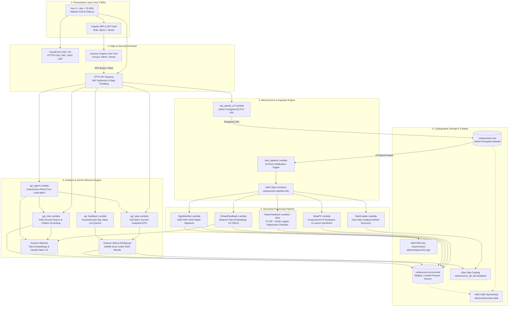
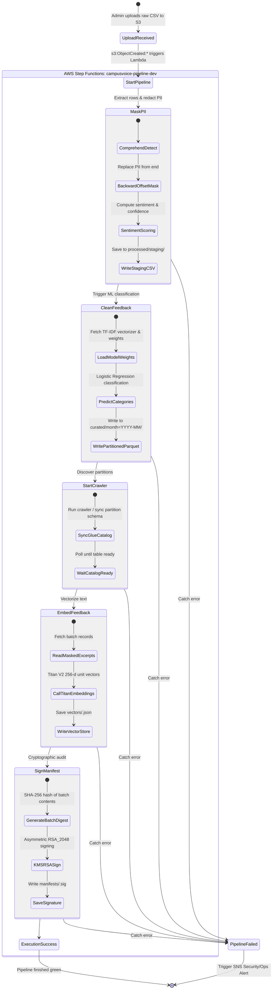
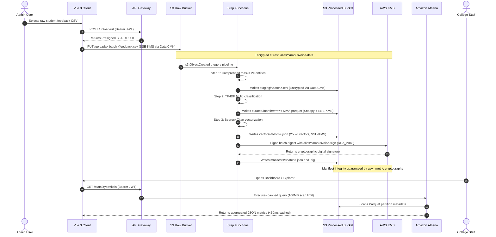

# CampusVoice: System Architecture & Technical Design

> **Project:** CampusVoice — Secure, Serverless AI & Big-Data Student Feedback Intelligence  
> **Course Program:** Wipro CPPE (Cloud Platform & Platform Engineering)  
> **Status:** Production Deployed & Verified  

---

## 1. End-to-End System Architecture

CampusVoice operates on a serverless lakehouse design on AWS, structured around the four Wipro CPPE core engineering modules:

---

## 2. Step Functions Orchestration Pipeline

The automated batch ingestion workflow coordinates data validation, PII redaction, machine learning classification, catalog discovery, embedding generation, and cryptographic manifest signing:

---

## 3. Defense-in-Depth Security Architecture

CampusVoice enforces multiple independent concentric security perimeters spanning identity, networking, compute, storage, cryptography, and application security:

```mermaid
flowchart TD
    subgraph Layer1 ["Layer 1: Identity & Access Management (IAM & Cognito)"]
        L1_A["Cognito User Pool with Self-Signup Disabled"]
        L1_B["Strict Password Policy (Min 10, Mixed Case, Digits)"]
        L1_C["Role-Based Access Control (RBAC): Admin vs. Viewer"]
        L1_D["Dedicated Least-Privilege IAM Roles per Lambda"]
        L1_E["GitHub Actions OIDC Trust (Zero Long-Lived Keys)"]
    end

    subgraph Layer2 ["Layer 2: Network Perimeter & VPC Isolation"]
        L2_A["VPC 10.0.0.0/16 with Isolated Private Subnets"]
        L2_B["Zero NAT Gateway (No Outbound Internet Egress)"]
        L2_C["AWS Gateway VPC Endpoint for S3 (Zero Cost Private Routing)"]
        L2_D["Default-Deny Security Groups & Glue Cluster SG"]
    end

    subgraph Layer3 ["Layer 3: Cryptography & Data Protection at Rest/Transit"]
        L3_A["AWS KMS Customer Managed Keys (CMKs) with Auto-Rotation"]
        L3_B["Compulsory SSE-KMS at Rest (DenyNonKmsPutObject Policy)"]
        L3_C["TLS 1.2+ Transport Enforcement (aws:SecureTransport = false)"]
        L3_D["S3 Public Access Block: 100% Enforced Across All 4 Buckets"]
        L3_E["RSA-2048 Asymmetric Digital Signatures on Batch Manifests"]
    end

    subgraph Layer4 ["Layer 4: Data Privacy & GenAI Safety"]
        L4_A["Amazon Comprehend Automated PII Masking (Names, Emails, Phones)"]
        L4_B["Student Direct Identifier Elimination (Data Minimization)"]
        L4_C["Bedrock XML Delimiter Wrapping (Prompt Injection Defense)"]
        L4_D["Strict Ground-Truth Citation Constraint ([1], [2] Only)"]
        L4_E["Automated Refusal on Out-of-Domain Inquiries"]
    end

    subgraph Layer5 ["Layer 5: Continuous Auditing & Threat Detection"]
        L5_A["AWS CloudTrail Global Management & S3 Data Events Logging"]
        L5_B["CloudWatch Logs Group with 7-Day KMS-Encrypted Retention"]
        L5_C["Metric Filter for UnauthorizedOperation & AccessDenied"]
        L5_D["Real-Time Security Alarm (>3 Denials in 5m -> SNS Alert)"]
        L5_E["CloudWatch Operational Dashboard (campusvoice-ops-dev)"]
    end

    Layer1 --> Layer2
    Layer2 --> Layer3
    Layer3 --> Layer4
    Layer4 --> Layer5
```

---

## 4. Data Flow & Cryptographic Encryption Checkpoints

All data moving through the lifecycle transitions through well-defined cryptographic state checkpoints:

