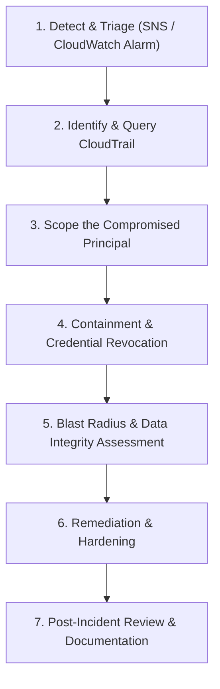

# CampusVoice: Security Incident Response Runbook

> **Target Audience:** Security Operations Center (SOC) / Cloud SecOps Team  
> **Classification:** Internal Security Playbook  
> **Course Module:** Wipro CPPE Module 4 (Cloud Security, Cryptography & Governance)

---

## 1. Overview & Threat Context

In the CampusVoice serverless data lakehouse architecture, all management operations and data access events on raw feedback buckets (`campusvoice-raw-*`), processed buckets, and KMS CMKs are audited continuously via **AWS CloudTrail** and delivered to **Amazon CloudWatch Logs** (`/aws/cloudtrail/campusvoice-dev`).

When unauthorized access or permission violations occur, the CloudWatch metric filter `AccessDeniedMetricFilter` flags these events. If 3 or more `AccessDenied` or `UnauthorizedOperation` events occur within a 5-minute window, the CloudWatch Alarm **`campusvoice-access-denied-dev`** trips into `ALARM` state and sends an immediate alert to the Security Admin SNS topic (`campusvoice-alerts-dev`).

---

## 2. Seven-Step Incident Response Procedure



### Step 1: Detect & Triage
- **Trigger:** SOC receives email alert from SNS topic `campusvoice-alerts-dev` indicating alarm state `ALARM` on `campusvoice-access-denied-dev`.
- **Triage Action:** Confirm that the alarm threshold ($\ge 3$ events in 300 seconds) was breached. Open CloudWatch Console -> Alarms -> `campusvoice-access-denied-dev`.

### Step 2: Query CloudTrail Audit Logs
Identify the exact unauthorized API calls, originating IP addresses, user agents, and error codes using CloudWatch Logs Insights or AWS CLI:

```bash
# Query CloudTrail Log Group for recent AccessDenied events
aws logs filter-log-events \
  --log-group-name "/aws/cloudtrail/campusvoice-dev" \
  --filter-pattern '{ ($.errorCode = "*UnauthorizedOperation") || ($.errorCode = "AccessDenied*") }' \
  --limit 20 \
  --query "events[*].message"
```

CloudWatch Logs Insights query:
```sql
fields @timestamp, userIdentity.arn, eventSource, eventName, sourceIPAddress, errorCode, errorMessage
| filter errorCode like /AccessDenied/ or errorCode like /UnauthorizedOperation/
| sort @timestamp desc
| limit 50
```

### Step 3: Scope the Compromised Principal
From the log payload, extract:
- **`userIdentity.arn`** (e.g., `arn:aws:iam::657878533694:user/campusvoice-admin` or compromised temporary role credentials)
- **`sourceIPAddress`** (check against corporate VPN or unexpected external IP)
- **Target Resources** (e.g., attempt to read `s3://campusvoice-raw-*-dev/` or call `kms:Decrypt` on `alias/campusvoice-sign`)

### Step 4: Containment & Immediate Credential Revocation
Isolate and revoke the compromised credentials immediately:
1. **For IAM Users:**
   ```bash
   # Deactivate active access keys immediately
   aws iam update-access-key --user-name <COMPROMISED_USER> --access-key-id <ACCESS_KEY_ID> --status Inactive
   ```
2. **For IAM Roles:**
   Attach an inline inline deny-all policy or revoke active role sessions using `AttachRolePolicy` with `arn:aws:iam::aws:policy/AWSDenyAll`.
3. **For KMS Keys:**
   If a cryptographic key is targeted, inspect the key policy:
   ```bash
   aws kms get-key-policy --key-id alias/campusvoice-data --policy-name default
   ```

### Step 5: Blast Radius & Data Integrity Verification
1. **S3 Bucket Integrity Check:**
   Verify that S3 Object Versioning is intact and no object versions were deleted or overwritten.
   ```bash
   aws s3api list-object-versions --bucket campusvoice-processed-657878533694-dev --prefix curated/
   ```
2. **Batch Manifest Cryptographic Signature Check:**
   Verify the digital signature of the latest batch manifest using the asymmetric KMS key (`alias/campusvoice-sign`):
   ```bash
   aws kms verify \
     --key-id alias/campusvoice-sign \
     --message fileb://<digest_file> \
     --message-type DIGEST \
     --signature fileb://<signature_file> \
     --signing-algorithm RSASSA_PKCS1_V1_5_SHA_256
   ```
   If `SignatureValid: true`, the curated feedback lake has not suffered tampering or unauthorized alteration.

### Step 6: Remediation & Security Hardening
- Rotate all compromised credentials and passwords.
- Verify that S3 Public Access Block remains `100% ENFORCED` on all 4 buckets (`Raw`, `Processed`, `Logs`, `Frontend`).
- Verify that bucket policies enforce TLS 1.2+ (`aws:SecureTransport: false` denial) and SSE-KMS CMK at rest.

### Step 7: Post-Incident Review & Documentation
- File SOC Incident Ticket with timestamps, indicators of compromise (IoCs), root cause analysis, and remediation actions.
- Update Wipro CPPE project compliance evidence records in `docs/security_controls.md`.

---

## 3. Threat Simulation Evidence

To validate that this detection mechanism triggers as designed:
1. Run the simulation script:
   ```powershell
   powershell -ExecutionPolicy Bypass -File scripts\simulate_suspicious_activity.ps1
   ```
2. Inspect CloudWatch Metrics for namespace `CampusVoice/Security`, metric `AccessDeniedCount`.
3. Confirm delivery of the SNS alert notification email to `sarathy01062005@gmail.com`.
