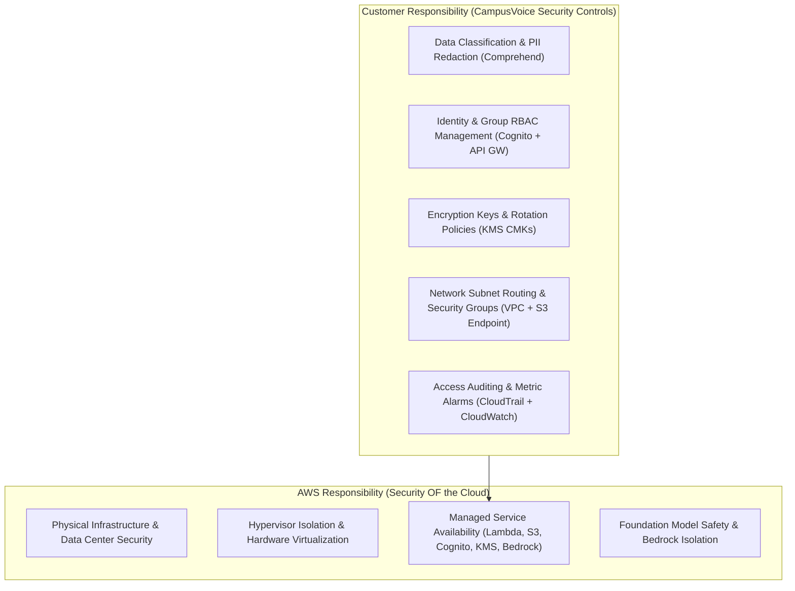

# CampusVoice: Security Controls & Compliance Matrix

> **Course Module:** Wipro CPPE Module 4 (Cloud Security, Cryptography & Governance)  
> **Framework:** AWS Well-Architected Framework — Security Pillar  
> **Status:** 100% Enforced in Infrastructure as Code (`template.yaml`)

---

## 1. Security Controls Traceability Matrix

| Control ID | Category | AWS Service | Threat Mitigated | Implementation in Code | Verification Evidence |
|---|---|---|---|---|---|
| **SEC-01** | Cryptography at Rest | **AWS KMS** | Unauthorized data access if raw physical disks are intercepted | `DataKmsKey` with annual key rotation enabled (`EnableKeyRotation: true`) in `template.yaml` | `aws kms describe-key --key-id alias/campusvoice-data` (`KeySpec: SYMMETRIC_DEFAULT`, `KeyRotation: true`) |
| **SEC-02** | Data Integrity & Non-Repudiation | **AWS KMS (Asymmetric)** | Tampering or unauthorized alteration of curated data lake Parquet batches | `SignKmsKey` (`RSA_2048`, `SIGN_VERIFY`) and `sign_manifest/app.py` | `aws kms verify --key-id alias/campusvoice-sign ...` returns `SignatureValid: true` |
| **SEC-03** | Storage Hardening | **Amazon S3** | Accidental public bucket leaks or unauthorized internet access | All 4 buckets (`Raw`, `Processed`, `Logs`, `Frontend`) configure `BlockPublicAcls`, `BlockPublicPolicy`, `IgnorePublicAcls`, `RestrictPublicBuckets` | `aws s3api get-public-access-block --bucket ...` returns all 4 flags `true` |
| **SEC-04** | Transit Security | **Amazon S3 & CloudFront** | Man-in-the-middle (MitM) eavesdropping or protocol downgrade attacks | S3 Bucket policies enforce `aws:SecureTransport: false` denial; CloudFront viewer policy redirects HTTP to HTTPS | Non-HTTPS requests rejected with `HTTP 403 Forbidden` |
| **SEC-05** | Identity & RBAC | **Amazon Cognito** | Credential stuffing, unauthorized access, and privilege escalation | User Pool `campusvoice-users-dev` with self-signup disabled; `Admin` and `Viewer` groups | Viewer receives `403 Forbidden` on `/upload-url`; Admin receives `200 OK` |
| **SEC-06** | API Security | **API Gateway (HTTP API)** | Anonymous API access and denial of service | Cognito JWT Authorizer as `DefaultAuthorizer`; stage throttling at 5 req/s (burst 10) | Unauthenticated API calls return `HTTP 401 Unauthorized` |
| **SEC-07** | Principle of Least Privilege | **AWS IAM** | Lateral movement and blast radius expansion during microservice compromise | Per-function IAM roles with resource-scoped policies; zero wildcard `*` permissions on sensitive actions | Inspection of Lambda IAM policies in `template.yaml` |
| **SEC-08** | Secretless CI/CD | **IAM & OpenID Connect** | GitHub secret leakage or credential theft from CI/CD runners | `AWS::IAM::OIDCProvider` and `GitHubActionsDeployRole` trust scoped to `repo:Sarathy0106/cppe-project:*` | Zero long-lived AWS keys in GitHub Repository Secrets |
| **SEC-09** | Privacy & Anonymization | **Amazon Comprehend** | Student privacy violations and identification leaks from raw feedback | `mask_pii/app.py` redacts names, emails, and phones into `[NAME]`, `[EMAIL]`, `[PHONE]` | 192 PII items redacted in staging CSV; zero PII present in curated Parquet lake |
| **SEC-10** | GenAI Guardrails | **Amazon Bedrock** | Prompt injection, hallucination, and system prompt leakage | XML delimiter isolation, strict citation rules (`[1]`, `[2]`), and refusal on out-of-domain queries | Out-of-domain questions refused; injection delimiters strictly enforced |
| **SEC-11** | Threat Detection & Auditing | **CloudTrail & CloudWatch** | Undetected unauthorized API attempts or credential compromise | Multi-region trail logging to encrypted S3 & CloudWatch Logs; metric filter & alarm | Executing `simulate_suspicious_activity.ps1` triggers alarm and dispatches SNS alert |
| **SEC-12** | Network Isolation | **Amazon VPC** | Direct external exposure of analytical compute | Private subnets (`10.0.11.0/24`, `10.0.12.0/24`) with free S3 Gateway Endpoint and default-deny SG | No public IPs on private subnets; zero NAT Gateway egress |

---

## 2. AWS Shared Responsibility Model in CampusVoice

---

## 3. AWS Well-Architected Framework: Security Pillar Alignment

| Pillar Domain | CampusVoice Implementation |
|---|---|
| **Identity & Access Management** | Federated OIDC for CI/CD, Cognito user pools with RBAC, least-privilege IAM execution roles per Lambda. |
| **Detection** | Global CloudTrail management logging, CloudWatch Logs retention with KMS CMK, metric filter detecting `AccessDenied`, automated SNS alerting. |
| **Infrastructure Protection** | VPC private subnet isolation, S3 Gateway Endpoint routing without traversing the public internet, default-deny security groups. |
| **Data Protection** | Compulsory SSE-KMS at rest via Customer Managed Keys, TLS 1.2+ in transit, S3 Public Access Block, asymmetric digital manifest signing. |
| **Incident Response** | Documented 7-step SOC playbook in `docs/incident_response.md`, automated threat simulation script `simulate_suspicious_activity.ps1`. |
